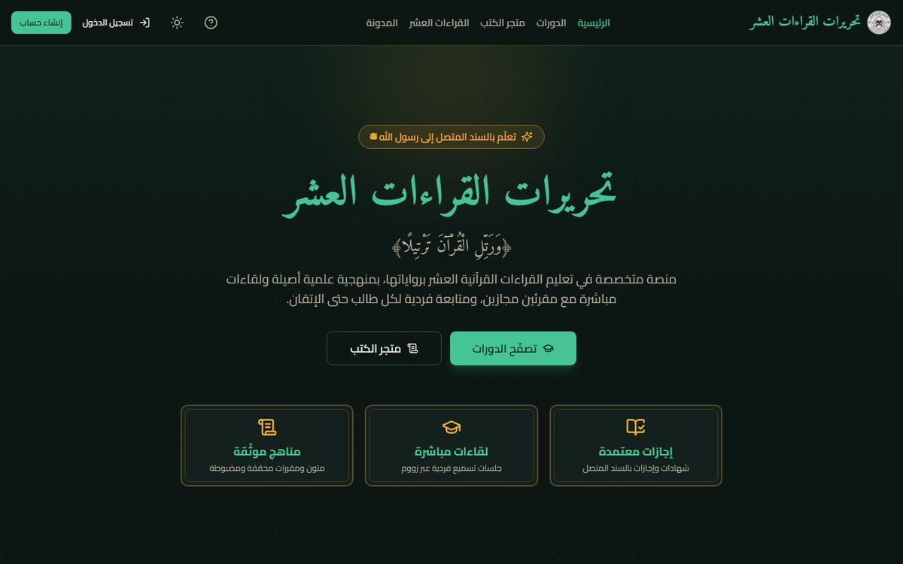
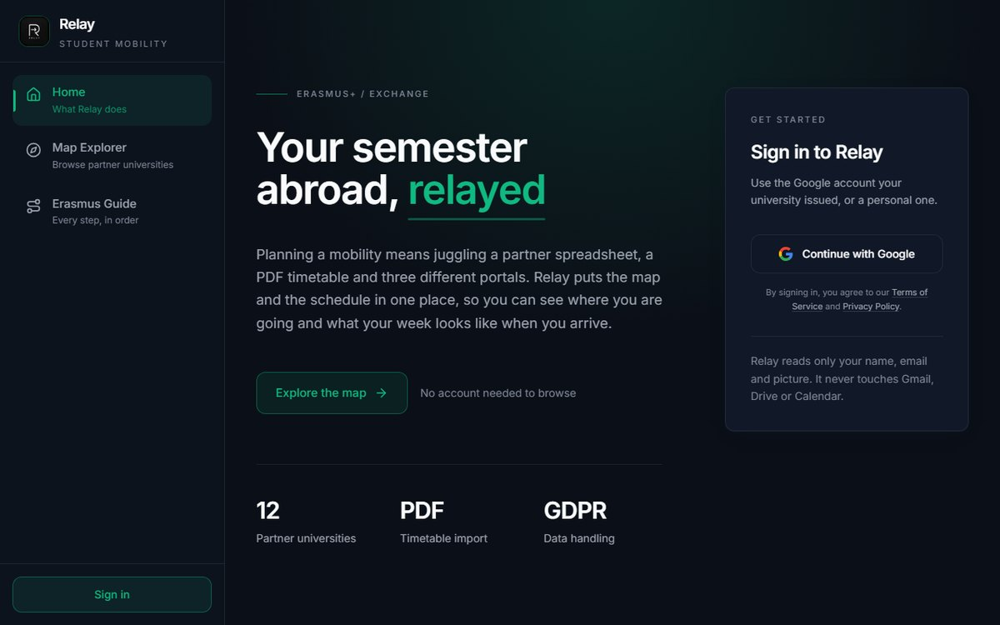
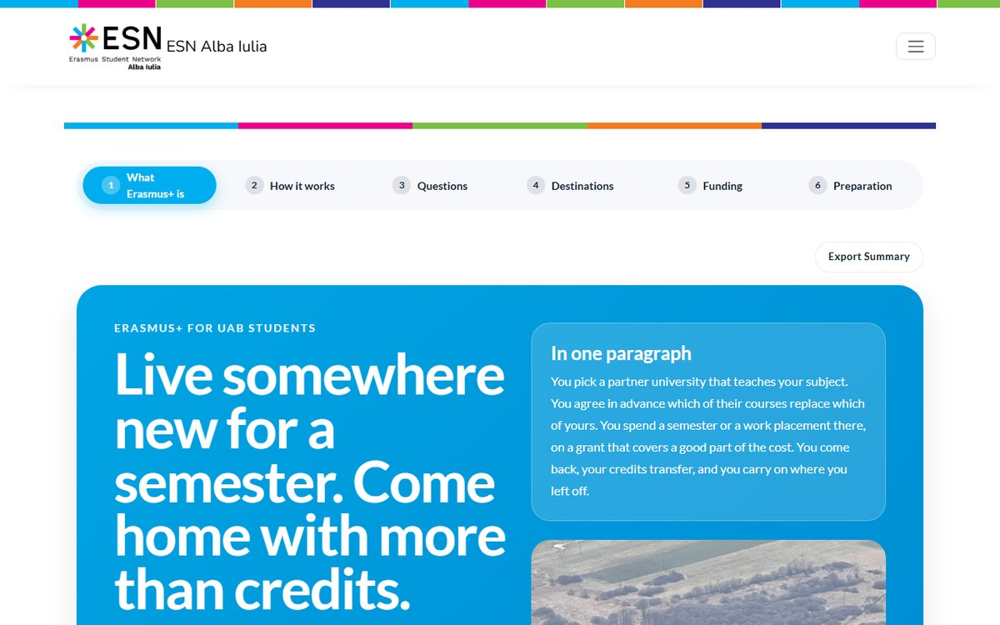

# Omar Zid

**I build websites, web apps and desktop tools for real people and real businesses.**

Based in Romania · TypeScript, Next.js, Supabase, Cloudflare and Python

[LinkedIn](https://www.linkedin.com/in/omarzid/) · [Email](mailto:neeezomargamer12@gmail.com) · [CV](https://github.com/tsarumar/tsarumar/blob/main/Omar%20Zid%20-%20CV%20-%20General.pdf)

## Selected work

<table>
<tr>
<td width="50%" valign="top">

<h3>Tahrirat.net</h3>
Production Arabic learning platform with courses, protected lessons, payments, recitation submissions and a full admin dashboard. Built and shipped solo.
  
Next.js · TypeScript · Supabase
 
<a href="https://tahrirat.net">Live site</a> · <a href="https://github.com/tsarumar/tahrirat-case-study">Case study</a>
</td>
<td width="50%" valign="top">

<h3>Paso</h3>
A seven-day beginner Spanish course with recorded audio, speaking and review practice, offline study and optional private progress sync.
  
TypeScript · Cloudflare
 
<a href="https://paso-spanish.pages.dev/">Live app</a>
</td>
</tr>
<tr>
<td width="50%" valign="top">

<h3>Relay</h3>
Student mobility app that puts Erasmus+ partner universities on a map and turns a PDF timetable into a weekly schedule, with a step-by-step guide.
  
Next.js · Prisma · Leaflet
 
<a href="https://relay-privat.vercel.app">Live app</a>
</td>
<td width="50%" valign="top">

<h3>SHOTBOX Site</h3>
Construction workspace in Romanian, English and Arabic. One daily report updates progress, attendance, materials and a client-ready summary.
  
TypeScript · Cloudflare D1
 
<a href="https://shotbox-site-preview.neeezomargamer12.workers.dev">Live preview</a>
</td>
</tr>
<tr>
<td width="50%" valign="top">

<h3>Erasmus+ Planning Tools</h3>
A guided browser toolkit for ESN Alba Iulia that helps students compare destinations, understand funding and prepare for their stay.
  
HTML · CSS · JavaScript
 
<a href="https://tsarumar.github.io/esn-erasmus-preview/">Live preview</a> · <a href="https://github.com/tsarumar/esn-erasmus-preview">Repository</a>
</td>
<td width="50%" valign="top">

<h3>Bistro GRAI</h3>
A bilingual restaurant website for a bistro in Alba Iulia, with the menu, directions and quick ways to call or message for a reservation.
  
HTML · JavaScript
 
<a href="https://bistro-grai.vercel.app">Live site</a>
</td>
</tr>
</table>

## Smaller builds

Public projects you can clone and run.

| Project | What it does | Built with |
| --- | --- | --- |
| [File Search Indexer](https://github.com/tsarumar/File-Search-Indexer) | Indexes a folder tree and searches 40,000 files in about six milliseconds | Python, SQLite |
| [Online Chess Game](https://github.com/tsarumar/Online-Chess-Game) | Two-player browser chess with every rule, from castling to stalemate | JavaScript |
| [eShop](https://github.com/tsarumar/eShop-with-PHP-and-JavaScript) | Online store with customer and seller accounts, cart and checkout | PHP, MySQL |
| [Password Vault](https://github.com/tsarumar/Password-Vault) | Desktop password manager with encrypted storage and a master password | Python, SQLite |
| [Log File Analyzer](https://github.com/tsarumar/Log-File-Analyzer) | Finds repeating errors in log files, draws charts and exports reports | Python |
| [Media Library Tracker](https://github.com/tsarumar/Media-Library-Tracker) | Local catalogue for your books, films, series, games and albums | Python, SQLite |
