

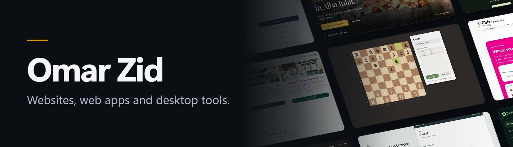

 

## Selected work

<table>
<tr>
<td width="50%" valign="top" align="center">
<a href="https://tahrirat.net">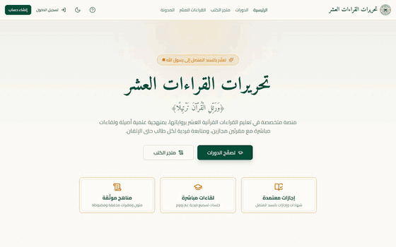</a>
  
<b>Tahrirat.net</b> 
Arabic learning platform, built and shipped solo 
<a href="https://tahrirat.net">Live site</a> · <a href="https://github.com/tsarumar/tahrirat-case-study">Case study</a>
</td>
<td width="50%" valign="top" align="center">
<a href="https://paso-spanish.pages.dev/">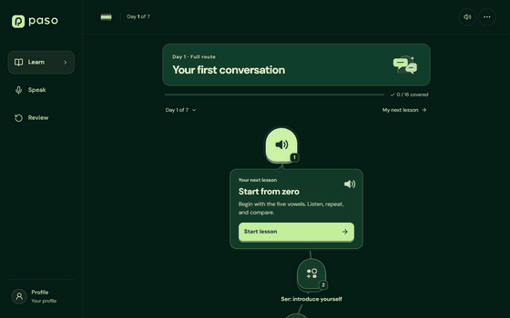</a>
  
<b>Paso</b> 
Seven-day Spanish course with recorded audio 
<a href="https://paso-spanish.pages.dev/">Live app</a>
</td>
</tr>
<tr>
<td width="50%" valign="top" align="center">
<a href="https://shotbox-site-preview.neeezomargamer12.workers.dev">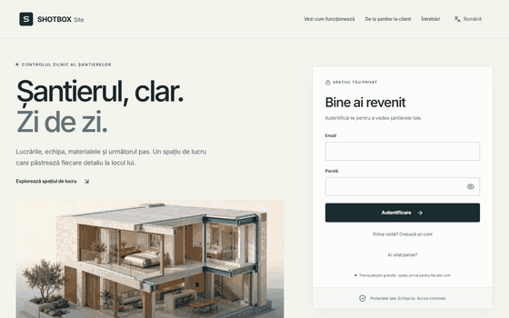</a>
  
<b>SHOTBOX Site</b> 
Daily reports for construction sites 
<a href="https://shotbox-site-preview.neeezomargamer12.workers.dev">Live preview</a>
</td>
<td width="50%" valign="top" align="center">

  
<b>Bistro GRAI</b> 
Bilingual restaurant website in Alba Iulia 
<a href="https://bistro-grai.vercel.app">Live site</a>
</td>
</tr>
<tr>
<td width="50%" valign="top" align="center">
<a href="https://tsarumar.github.io/esn-erasmus-preview/">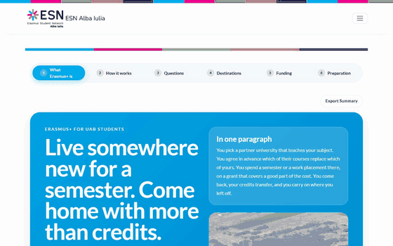</a>
  
<b>Erasmus+ Planning Tools</b> 
Step-by-step guide for ESN Alba Iulia students 
<a href="https://tsarumar.github.io/esn-erasmus-preview/">Live preview</a> · <a href="https://github.com/tsarumar/esn-erasmus-preview">Code</a>
</td>
<td width="50%" valign="top" align="center">
<a href="https://github.com/tsarumar/Online-Chess-Game">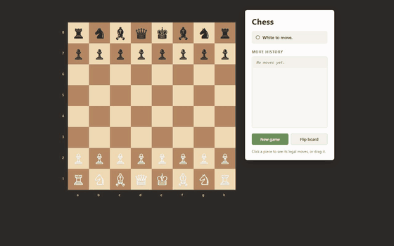</a>
  
<b>Online Chess Game</b> 
Browser chess with every rule, no libraries 
<a href="https://github.com/tsarumar/Online-Chess-Game">Code</a>
</td>
</tr>
</table>

## More projects

<table>
<tr>
<td width="33%" valign="top" align="center">
<a href="https://github.com/tsarumar/File-Search-Indexer">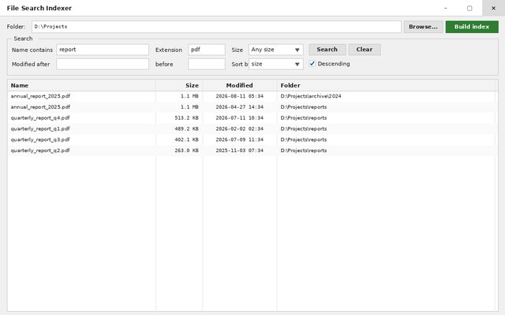</a>
 
<a href="https://github.com/tsarumar/File-Search-Indexer"><b>File Search Indexer</b></a> 
Python · SQLite
</td>
<td width="33%" valign="top" align="center">
<a href="https://github.com/tsarumar/eShop-with-PHP-and-JavaScript">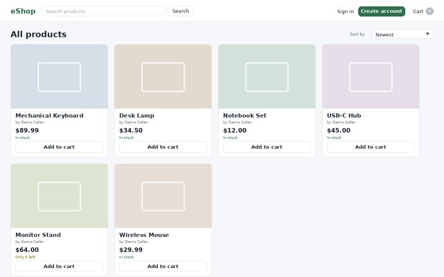</a>
 
<a href="https://github.com/tsarumar/eShop-with-PHP-and-JavaScript"><b>eShop</b></a> 
PHP · MySQL
</td>
<td width="33%" valign="top" align="center">
<a href="https://github.com/tsarumar/Log-File-Analyzer">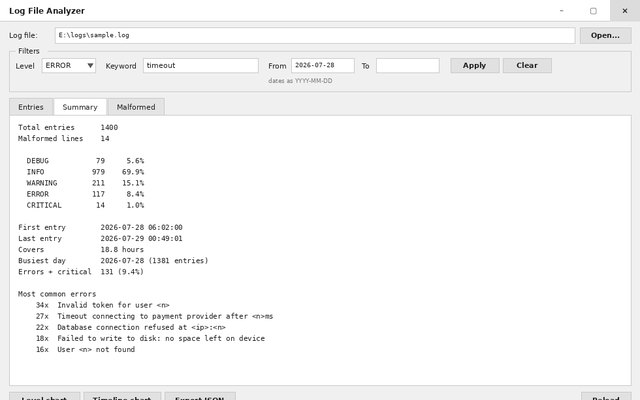</a>
 
<a href="https://github.com/tsarumar/Log-File-Analyzer"><b>Log File Analyzer</b></a> 
Python
</td>
</tr>
<tr>
<td width="33%" valign="top" align="center">
<a href="https://github.com/tsarumar/Media-Library-Tracker">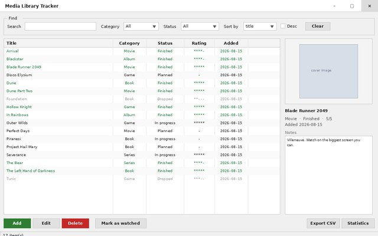</a>
 
<a href="https://github.com/tsarumar/Media-Library-Tracker"><b>Media Library Tracker</b></a> 
Python · SQLite
</td>
<td width="33%" valign="top" align="center">
<a href="https://github.com/tsarumar/Password-Vault">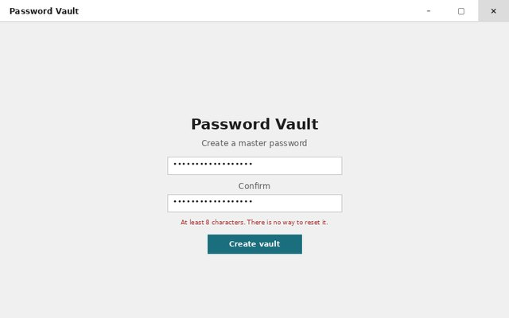</a>
 
<a href="https://github.com/tsarumar/Password-Vault"><b>Password Vault</b></a> 
Python · SQLite
</td>
<td width="33%" valign="top" align="center">
<a href="https://github.com/tsarumar/Smart-File-Organizer">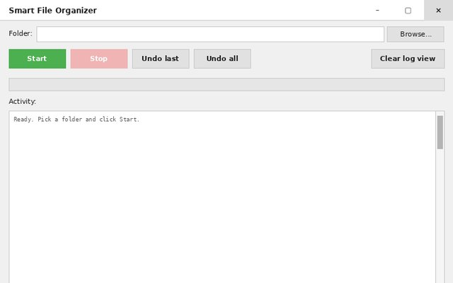</a>
 
<a href="https://github.com/tsarumar/Smart-File-Organizer"><b>Smart File Organizer</b></a> 
Python
</td>
</tr>
</table>
